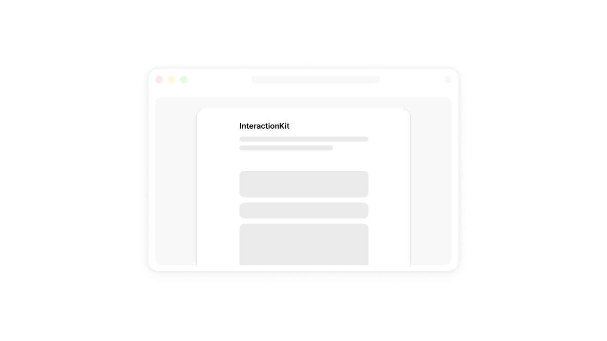

# InteractionKit



InteractionKit is becoming a React component package for web apps that feel native and fluid. The original copy-ready interaction studies remain available in the archive while we prepare the 2.0 components.

The npm package is named **[`useintkit`](https://www.npmjs.com/package/useintkit)**; the project and website remain InteractionKit.

```bash
npm install useintkit
```

The package, demo collection, and documentation UI have separate source boundaries. Moving a prototype into the package is a deliberate step, not an automatic export.

## Stack

- React 19 and Next.js 15
- Tailwind CSS for styling
- Framer Motion for interaction and animation
- Lucide for icons
- Static export for deployment to Vercel, GitHub Pages, or another static host

## Project Structure

```text
app/                 Landing page and individual demo routes
app/archive/         Original interaction gallery
src/components/      Package components and their colocated tests
src/examples/        Current Button, ImageViewer, and Sheet examples
app/_components/     Website-only gallery interactions and legacy page helpers
src/site/            Documentation UI used only by the website
src/test/            Shared test setup and package-boundary checks
src/index.ts         Explicit public package exports
lib-package.json     Manifest copied into the distributable package
rollup.config.mjs    ESM, CommonJS, declaration, and CSS Module extraction builds
```

## Development

```bash
npm install
npm run dev
```

Visit `http://localhost:3000/archive` to explore the original live demos and copy component source code. The homepage is reserved for InteractionKit 2.0; existing demo URLs still work.

Metadata uses `https://interactionkit.org` as the public site URL, including for absolute social image URLs. Set `NEXT_PUBLIC_SITE_URL` to override it for another deployment (including any deployment subpath). The shared social preview is `app/opengraph-image.jpg`.

## Scripts

```bash
npm run dev          # Start the local Next.js development server
npm run build        # Create a production static export
npm run build:lib    # Build the distributable component library
npm run test         # Run the component tests with Vitest
npm run typecheck    # Check TypeScript without emitting files
npm run check:lib    # Build and smoke-test the prepared npm package
npm run pack:lib     # Inspect the npm release contents without publishing
```

## Contributing

See [COMMIT.md](COMMIT.md) for branch naming, Conventional Commits, and the pull request workflow.

Keep current package examples in `src/examples` and legacy gallery implementations in `app/_components`. The underscore marks a private Next.js folder, not a route. Documentation UI belongs in `src/site`. Package components in `src/components` must not import from these directories, from Next.js, or from Node.js built-ins. Only exports in `src/index.ts` are public. `app/demo` contains the route entries for existing archive URLs.

Components should be self-contained, responsive, keyboard-accessible, and respect reduced-motion preferences. Keep tests beside the implementation. Run `npm test`, `npm run build`, and `npm run check:lib` before opening a pull request.

### Package readiness

The new package components are `Button`, `ImageViewer`, and `Sheet`, all with standalone styles and reduced-motion support. Button supplies a white/near-black primary surface, layered shadows, spring press feedback, and loading/disabled states. ImageViewer and Sheet support controlled state, native modal focus containment, focus restoration, and scroll locking. The website's four-image grid is an example built with ImageViewer, not a required package layout. Sheet provides a scrollable body, fixed footer, and handle-only drag dismissal.

```tsx
import "useintkit/styles.css";
import { ImageViewer } from "useintkit";

<ImageViewer src="/images/coast.jpg" alt="A quiet coastline" />
```

The new components use colocated CSS Modules. The library build compiles the class maps into JavaScript and extracts their scoped styles into one `styles.css` file, without a global reset or runtime style injection. Consumers need neither Tailwind nor CSS Modules tooling. The website and demos continue to use Tailwind. Motion handles gestures and springs; CSS handles static presentation and visual states.

Add a `.dark` class on an ancestor to use the dark appearance. Customize components with the existing class hooks or inherited `--ik-*` CSS variables, all with working defaults. For example:

```css
.my-app {
  --ik-button-radius: 12px;
  --ik-sheet-width: 520px;
  --ik-focus-color: #2563eb;
}
```

See the component READMEs in `src/components/button`, `src/components/image-viewer`, and `src/components/sheet` for the APIs and available tokens. `npm run build:lib:watch` watches the component CSS as well as TypeScript.

The package exports only `Button`, `ImageViewer`, and `Sheet`. Legacy FeedbackMorph and notification implementations are website-only and live in `app/_components`, using the website's Tailwind styling.

The build preserves the client boundary, keeps React and Motion external, and emits separate ESM and CommonJS entry points. The initial published version is `0.0.0` (`major.minor.patch`); future work includes migrating the remaining components to the standalone styling approach.

### npm releases

The package name and version live in `lib-package.json`. The website reads that version and links to the matching npm package page. The root `package.json` is private and belongs to the website/build tooling, not the published package.

1. Confirm the package name, npm name availability, and initial release version in `lib-package.json`. Prefer a prerelease version while the API is evolving.
2. Run `npm login`, then `npm whoami` to verify the account.
3. Run `npm run pack:lib` and inspect the files. It builds and validates the package but does not publish it.
4. When ready, run `npm run publish:lib`. For a preview release, use `npm run publish:lib -- --tag next` so it does not become the default `latest` release.

Publishing runs the tests and library checks first. The distributable includes its stylesheet, declarations, README, and MIT license, and is configured as a public package on the npm registry. If npm stages a release, a maintainer must approve it before it becomes available. Never commit npm tokens or put them in website environment variables.

After publishing a version, push a matching Git tag (for example, `v0.0.0`) to create a GitHub release with generated notes. The release workflow checks the tag against `lib-package.json` and does not publish to npm.

## License

MIT
